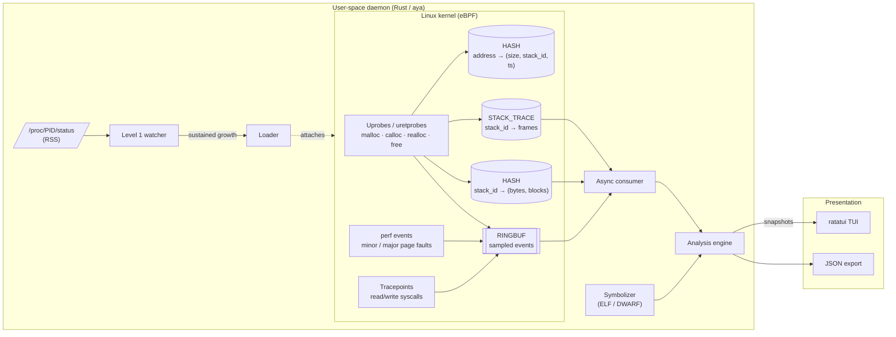

# dmld — Dynamic Memory Leak Detector

> An eBPF-based memory leak detector and observability tool for Linux, written in Rust.
> One static binary that attaches to a running process. No recompiling, no restart.


-b7410e)


> ⚠️ **Work in progress.** This README describes the target design. See the [roadmap](#roadmap) for what is implemented today.

---

## Table of contents

- [Motivation](#motivation)
- [Features](#features)
- [Architecture](#architecture)
- [Leak detection algorithm](#leak-detection-algorithm)
- [Requirements](#requirements)
- [Building](#building)
- [Usage](#usage)
- [Repository layout](#repository-layout)
- [Overhead](#overhead)
- [Known limitations](#known-limitations)
- [Roadmap](#roadmap)
- [Contributing](#contributing)
- [License](#license)
- [References](#references)

---

## Motivation

> New to allocators, pages or call stacks? Read [Background: how memory allocation works on Linux](docs/background.md) first.

Finding memory leaks in production on Linux is hard with today's tools.

**Valgrind's Memcheck is too slow to use in production.** Valgrind runs the program on a synthetic CPU. When code runs for the first time, Valgrind translates it, the selected tool adds its own instrumentation, and only then does the instrumented code execute. Valgrind does this for every instruction, including the instructions in shared libraries such as the C library.[^valgrind-core] The Valgrind manual estimates that Memcheck makes a program run **10–50× slower**[^valgrind-core] and use more memory. The quick-start guide quotes **20–30×**.[^valgrind-qs] A server that slow cannot handle its real traffic, so you never see the leak as it actually happens in production.

**LeakSanitizer (LSan) is cheap, but it needs a rebuild and only checks at exit.** LSan is enabled by default with AddressSanitizer, or on its own with `-fsanitize=leak`. It *"adds almost no performance overhead until the very end of the process"*.[^lsan] Three things make it a poor fit for a long-running production service:

- **The program must be rebuilt** with the sanitizer flag.[^lsan]
- **The check runs only when the process terminates.**[^lsan] A server running for weeks never reaches that point. Running the check earlier means calling `__lsan_do_leak_check()` from the code.
- **It only reports unreachable memory.** At the end of the process, LSan scans globals, stacks, registers and thread-local storage for values that look like pointers to heap blocks. It then reports the blocks that nothing points to.[^lsan-design] Memory that is still referenced but grows without bound, such as an unbounded cache or a list that is never purged, is not reported. In long-running services this is a common kind of leak.

LSan remains the right tool in development and CI, where it gives exact answers for unreachable blocks. dmld complements it in production. It needs no rebuild, observes the process while it is running, and looks at growth rather than reachability, so it can also flag referenced memory that keeps growing.

**Runtime-compiled eBPF tools are heavy to deploy.** BCC tools like `memleak.py` compile their BPF code with Clang/LLVM on the target machine at startup. This has three costs. You have to ship a large Clang/LLVM library. You need kernel headers on the host. And the compilation uses a lot of resources, which can disrupt the production workload it is supposed to observe.[^co-re]

**dmld** takes a different approach. The eBPF bytecode is compiled ahead of time and embedded in a single Rust binary built with [`aya`](https://aya-rs.dev). The target machine needs no compiler, no Python and no kernel headers.

## Features

| Feature | Description |
|---|---|
| **Allocation tracing** | Uprobes on `malloc`, `calloc`, `realloc` and `free` (glibc, musl). Support for `jemalloc` and `tcmalloc` is planned. The allocator is detected automatically (see [Allocator detection](#allocator-detection)). |
| **Attach to a live process** | Attaches by PID. The target process is never restarted or recompiled (see [Attaching to a running process](#attaching-to-a-running-process)). |
| **Two-level monitoring** | A near-zero-cost watch on resident memory runs all the time. The more expensive allocation tracing starts only when memory keeps growing (see [Two-level monitoring](#two-level-monitoring)). |
| **Resolved call stacks** | Stacks are captured in the kernel and symbolized in user space from ELF/DWARF data (function, file and line). |
| **False-positive filtering** | Age and trend heuristics separate real leaks from caches that grow and then stabilize. |
| **Memory/latency correlation** | Tracks minor and major page faults and `read`/`write` latency to show what a leak costs the system (see [Measuring the cost of a leak](#measuring-the-cost-of-a-leak)). |
| **Terminal UI** | Live dashboard built with [`ratatui`](https://ratatui.rs): top leaking stacks, call stacks and trend charts. |
| **JSON export** | Headless mode for CI or offline analysis. |

## Architecture

dmld has three layers:



### A. eBPF programs (kernel space)

| Probe | Type | Purpose |
|---|---|---|
| `malloc` / `calloc` / `realloc` entry | `uprobe` | Stores the requested size, keyed by thread ID. |
| `malloc` / `calloc` / `realloc` return | `uretprobe` | Reads the returned address, captures the user stack with `bpf_get_stackid(BPF_F_USER_STACK)`[^bpf-helpers] and records the allocation. |
| `free` | `uprobe` | Removes the allocation and decrements its stack's counters. |
| `PERF_COUNT_SW_PAGE_FAULTS_MIN` / `_MAJ` | `perf_event` | Counts minor and major page faults per process.[^perf-event] |
| `syscalls:sys_{enter,exit}_{read,write}` | `tracepoint` | Measures I/O latency per process. |

Main maps:

| Map | Type | Key → value |
|---|---|---|
| `ALLOCS` | `HASH` | address → `{ size, stack_id, timestamp }` |
| `STACK_STATS` | `HASH` | `stack_id` → `{ live_bytes, live_blocks, total_allocated }` |
| `STACKS` | `STACK_TRACE` | `stack_id` → user-space frames |
| `PENDING` | `HASH` | thread ID → pending size (between `malloc` entry and return) |
| `EVENTS` | `RINGBUF` | sampled events sent to user space |

**Design choice: aggregate in the kernel.** Per-stack counters stay in `HASH` maps, and only sampled events and I/O metrics go through the ring buffer. A program can make millions of allocations per second. Sending each one to user space would make transport the bottleneck.

**Why a ring buffer rather than a perf buffer:** the BPF ring buffer is shared across CPUs. It uses memory more efficiently than per-CPU perf buffers and keeps events from different CPUs in order.[^ringbuf]

### B. User-space daemon (Rust)

- **Level 1 watcher:** polls the target's resident memory and decides when to start allocation tracing (see [Two-level monitoring](#two-level-monitoring)).
- **Loader:** embeds the compiled eBPF object, loads it with `aya` and attaches probes to the allocator library mapped into the target process.
- **Async consumer:** reads the ring buffer and periodically polls the aggregation maps.
- **Symbolizer:** resolves addresses using [`blazesym`](https://github.com/libbpf/blazesym), which supports ELF and DWARF (including source file, line and inlined functions) and runs in production at Meta.[^blazesym]
- **Analysis engine:** keeps a time series per stack and computes a leak score (see below).

### C. Terminal UI (`ratatui`)

The analysis engine publishes immutable snapshots, and the render loop reads them. Drawing the UI never blocks data collection.

```
┌ dmld ─ pid 4242 (my-server) ─────────────────────────── uptime 00:12:31 ┐
│ RSS 412 MiB ▲ +1.2 MiB/min   Page faults 3.1k/s   p99 read 4.8 ms ▲     │
├ Suspected leaks ─────────────────────────────────────────────────────────┤
│ Score  Live bytes   Blocks   Growth        Origin                        │
│ 0.94   128.4 MiB    52 310   +640 KiB/min  parse_request (http.c:212)    │
│ 0.71    12.0 MiB     3 002   +48 KiB/min   cache_insert (lru.c:88)       │
│ 0.12     4.1 MiB       810   stable        load_config (cfg.c:40)        │
├ Call stack ──────────────────────────┬ Memory / latency ─────────────────┤
│ #0 malloc                            │ ⣀⣀⣠⣤⣤⣴⣶⣶⣾⣿  live bytes            │
│ #1 buffer_new        buffer.c:31     │ ⣀⣀⣀⣠⣠⣤⣤⣴⣶⣾  p99 read              │
│ #2 parse_request     http.c:212      │                                   │
│ #3 handle_conn       server.c:97     │                                   │
└──────────────────────────────────────┴───────────────────────────────────┘
 [↑↓] navigate  [Enter] details  [s] sort  [f] filter  [e] export  [q] quit
```

*(Mock-up. The final layout may change.)*

### Attaching to a running process

dmld uses uprobes, so it never has to launch, restart or modify the target. Uprobes are placed on a file at a given offset, not in the process's memory:[^uprobetracer]

1. dmld reads `/proc/<pid>/maps` to find which allocator library the process has loaded, for example `/usr/lib/libc.so.6`.[^proc-maps]
2. It looks up the offset of `malloc` in that file's ELF symbol table.
3. It asks the kernel to place a uprobe at that offset, filtered on the target PID.
4. The kernel replaces the first instruction of `malloc` with a breakpoint. Every time `malloc` is called, the kernel runs the eBPF program, then executes the original instruction and resumes the process.

When dmld exits, the kernel removes the probes. The file on disk is never modified.

**What dmld cannot see:** allocations made before it attached. When one of those blocks is freed, `free` receives an address that is not in `ALLOCS`, and that call is ignored. "Live bytes" therefore count memory allocated since dmld attached, not the process's whole heap.

### Allocator detection

`malloc` comes from whichever allocator the process uses. If dmld probes the wrong one, it sees almost nothing and would report no leak. The allocator is detected in three steps:

1. **Shared libraries.** dmld looks in `/proc/<pid>/maps` for known allocators (`libjemalloc.so`, `libtcmalloc.so`, `libmimalloc.so`). `libc.so.6` is always loaded, so seeing it proves nothing. What matters is which library provides `malloc`. The dynamic linker binds each symbol to the first definition it finds: the executable, then `LD_PRELOAD` libraries, then the other libraries in load order.[^ld-so] A loaded `libjemalloc.so` therefore takes precedence over the libc's `malloc`.
2. **The executable itself.** The allocator can be linked into the binary. dmld reads the executable's symbol table (`/proc/<pid>/exe`). If `malloc` is defined there, probes go on the binary. Prefixed symbols reveal an embedded allocator: `_rjem_malloc` (Rust `tikv-jemallocator`), `je_malloc` (jemalloc), `mi_malloc` (mimalloc), `tc_malloc` (tcmalloc).
3. **Fallback.** dmld probes the libc found in `maps`: `libc.so.6` (glibc) or `ld-musl-*.so.1` (musl).

For processes in containers, paths are opened through `/proc/<pid>/root/` so they resolve in the container's filesystem.

dmld always prints the allocator it picked. If a busy process produces no `malloc` events after a few seconds, dmld warns that the allocator is probably wrong, rather than reporting "no leak". `--allocator` overrides detection, for example for stripped binaries.

### Two-level monitoring

Uprobes on `malloc` are the expensive part (see [Overhead](#overhead)). dmld only uses them when there is a reason to:

| Level | What runs | Cost | What it tells you |
|---|---|---|---|
| **1. Watch** (always on) | Polls resident memory (`VmRSS`) in `/proc/<pid>/status`[^proc-status] | Near zero, no eBPF | "This process's RAM usage keeps growing: worth investigating." |
| **2. Investigate** | Uprobes on `malloc`/`free` with stack capture | Higher | "This memory comes from `parse_request` and is never freed." |

Level 1 alone can't prove a leak. RSS mixes what the program actually uses with memory the allocator keeps on purpose. For example, glibc keeps freed blocks for reuse and only returns memory to the kernel when more than 128 KiB is free at the top of the heap.[^mallopt] A high RSS that never drops can be allocator policy, not a leak. Level 1 only decides when to start level 2, which sees every individual block.

**Disabling it: `--no-watch`.** This flag skips level 1 and attaches the uprobes as soon as dmld starts. Use it when:

- **you can afford the overhead**, for example in staging, in CI or on a test machine;
- **the leak is too slow to trip the trigger**: a small leak can stay below `--trigger` for a long time, while level 2 would already see it;
- **you want the full history**: level 2 only sees allocations made after it starts, so the earlier the uprobes are attached, the more blocks dmld can follow;
- **the process is short-lived**: it may exit before level 1 has collected enough samples to trigger.

The allocator's system calls (`brk`, `mmap`) are not used as a signal either. They show the address space the allocator has reserved. That is neither what the program uses (blocks recycled inside the allocator involve no system call) nor what is in RAM (reserved pages use no memory until touched).

### Measuring the cost of a leak

A leak matters when it slows the system down. As memory fills up, the kernel reclaims the page cache, then swaps pages out. This shows up in three metrics, which dmld plots on the same timeline as live bytes:

- **Minor page faults:** the first access to newly allocated memory. They are cheap and show memory being put to use.
- **Major page faults:** the page has to be read back from disk, for example from swap.[^perf-event] They are much slower, and their rate rises once the leak creates memory pressure.
- **`read`/`write` latency:** measured between syscall entry and exit. With a smaller page cache, reads that were served from RAM now go to disk.

The kernel classifies a fault as minor or major only after it has handled the fault. dmld therefore attaches to the `PERF_COUNT_SW_PAGE_FAULTS_MIN` and `_MAJ` software events. These are defined on every architecture. The `exceptions:page_fault_user` tracepoint is not: it was x86-only until Linux 6.16, and since then only x86 and RISC-V emit it (arm64, for example, does not).[^pf-tp] That tracepoint also fires before the fault is resolved, so it can't tell minor from major. If you only need per-process totals, `/proc/<pid>/stat` already exposes `minflt` and `majflt`.

These curves show a **correlation**, not a proof of causation. Latency can also rise for other reasons, such as another process saturating the disk.

## Leak detection algorithm

An allocation that hasn't been freed isn't necessarily a leak: caches, pools and global buffers all hold memory on purpose. BCC's `memleak` handles this with one global age threshold. By default, it only reports allocations older than 500 ms.[^memleak-man] A single threshold can't fit every call site. A request buffer and a configuration table have very different normal lifetimes. dmld combines two signals instead, both computed **per call stack**.

**1. Relative age**

For each `stack_id`, dmld records how long blocks from that stack live before they are freed. A block that is still live is suspect when its age is far above that stack's normal lifetime:

```
suspect(block) ⇔ age(block) > k × p99(lifetime of freed blocks from the same stack)
```

For example, if a stack's blocks usually live for 2 ms (one request) and some are now 10 minutes old, that stack is a strong suspect.

**2. Trend of live bytes**

dmld fits a linear regression to each stack's live bytes over a sliding window:

| Observed pattern | Slope | Interpretation |
|---|---|---|
| Steady linear growth (high R²) | > 0 | **Likely leak** |
| Growth, then plateau | → 0 | Cache or pool reaching steady state: ignored |
| Oscillation around a mean | ≈ 0 | Normal behaviour |
| Step-wise growth | > 0, low R² | Watch |

**Score:** a weighted mix of normalized slope, R², the share of suspect blocks and the allocated/freed ratio, scaled to `[0, 1]`. Confidence grows with observation time. A warm-up period (`--warmup`) prevents alerts during startup, when every allocation is still young and growing.

## Requirements

### Target machine (runtime)

| Requirement | Why |
|---|---|
| **Linux kernel ≥ 5.8** | Two features this design depends on first appeared in 5.8: the BPF ring buffer (`BPF_MAP_TYPE_RINGBUF`)[^ringbuf][^kernel-versions] and the `CAP_BPF` / `CAP_PERFMON` capabilities.[^caps] |
| **x86_64** (aarch64 planned) | x86_64 is the first platform built and tested. Nothing in the design is specific to x86: the page-fault events and probes used are available on every architecture.[^perf-event] |
| **`root`, or `CAP_BPF` + `CAP_PERFMON`** | `CAP_BPF` is required to load BPF programs and create maps. `CAP_PERFMON` is required for `perf_event_open(2)`, which is used to attach uprobes and tracepoints. Both capabilities were split out of the much broader `CAP_SYS_ADMIN` in 5.8, so you don't have to run as full root.[^caps] |
| **`CAP_SYS_PTRACE`** (only for other users' processes) | dmld reads `/proc/<pid>/maps` and the target's binaries to place probes and symbolize stacks. Inspecting another user's process through `/proc` requires this capability.[^caps] |
| **Target built with frame pointers** (recommended) | The kernel walks the user stack using frame pointers. Without them, *"any stack walking stops at the libc layer, producing a partial stack that's missing the application frames"*.[^frame-pointers] GCC has omitted frame pointers by default since 2004. Fedora, Ubuntu 24.04 and Arch now re-enable them across the distribution, at a typical cost of under 1%.[^frame-pointers] Build with `-fno-omit-frame-pointer` (C/C++) or `-C force-frame-pointers=yes` (Rust). |
| **No other dependencies** | The binary is linked statically against musl and embeds its eBPF bytecode. The target needs no Clang/LLVM, no kernel headers and no Python, unlike runtime-compiled tools such as BCC.[^co-re] |

### Development machine (build)

| Requirement | Why |
|---|---|
| **Rust stable** | Builds the user-space daemon.[^aya-dev] |
| **Rust nightly + `rust-src`** | eBPF programs target `bpfel-unknown-none`, which has no prebuilt standard library. `core` has to be rebuilt from source, and that requires a nightly toolchain.[^aya-dev] |
| **[`bpf-linker`](https://github.com/aya-rs/bpf-linker)** | Links the Rust eBPF object files into loadable BPF bytecode.[^aya-dev] Install the prebuilt binary with `cargo-binstall`. A plain `cargo install bpf-linker` builds it from source and needs a matching system LLVM, which the project does not recommend.[^bpf-linker] |
| **`x86_64-unknown-linux-musl` target** | Produces a fully static binary, so nothing needs to be installed on the target. |
| **A Linux host or VM** (≥ 5.8) | eBPF programs only load into a Linux kernel. Integration tests need root on such a host. |

```bash
rustup toolchain install stable
rustup toolchain install nightly --component rust-src
cargo install cargo-binstall
cargo binstall bpf-linker
rustup target add x86_64-unknown-linux-musl
```

## Building

```bash
git clone https://github.com/<user>/dynamic-memory-leak-detector.git
cd dynamic-memory-leak-detector

cargo build --release                                   # eBPF programs + daemon
cargo build --release --target x86_64-unknown-linux-musl  # static binary for deployment
```

The resulting `dmld` binary contains the eBPF bytecode. To deploy it, copy that one file to the target.

## Usage

> The CLI is still being designed, and these options may change.

```bash
# Attach to a running process with the TUI
sudo dmld --pid 4242

# Launch a command and trace it
sudo dmld -- ./my-server --port 8080

# Headless: observe for 10 minutes, then write a JSON report
sudo dmld --pid 4242 --duration 10m --output report.json

# Force the allocator, and sample about 1 allocation in 16
sudo dmld --pid 4242 --allocator jemalloc --sample-rate 16

# Skip level 1 and trace allocations right away
sudo dmld --pid 4242 --no-watch
```

| Option | Description | Default |
|---|---|---|
| `-p, --pid <PID>` | Process to trace | — |
| `--allocator <glibc\|musl\|jemalloc\|tcmalloc>` | Override [allocator detection](#allocator-detection) | auto-detect |
| `--no-watch` | Disable [two-level monitoring](#two-level-monitoring): attach uprobes immediately | off |
| `--trigger <RATE>` | Sustained RSS growth that starts level 2 | `1MiB/min` |
| `--sample-rate <N>` | Record about 1 allocation out of N, picked at random | `1` |
| `--sample-bytes <BYTES>` | Record about one allocation per BYTES allocated (alternative to `--sample-rate`) | off |
| `--min-size <BYTES>` | Ignore smaller allocations | `0` |
| `--warmup <DURATION>` | No alerts during this initial period | `30s` |
| `--duration <DURATION>` | Stop automatically after this time | unlimited |
| `--output <FILE>` | Write a JSON report (disables the TUI) | — |
| `--no-io` | Disable I/O correlation | — |

## Repository layout

The repository is a Cargo workspace that follows the [`aya-template`](https://github.com/aya-rs/aya-template) structure:

```
dynamic-memory-leak-detector/
├── dmld/                  # User-space daemon (binary)
│   └── src/
│       ├── main.rs        # CLI, orchestration
│       ├── watcher.rs     # Level 1: RSS polling
│       ├── allocator.rs   # Allocator detection
│       ├── loader.rs      # Load and attach eBPF programs
│       ├── collector.rs   # Ring buffer + map polling
│       ├── symbolizer.rs  # ELF / DWARF resolution
│       ├── analysis/      # Detection engine (age, trend, score)
│       ├── tui/           # ratatui interface
│       └── export.rs      # JSON report
├── dmld-ebpf/             # eBPF programs (no_std, bpfel-unknown-none)
│   └── src/
│       ├── main.rs
│       ├── alloc.rs       # malloc/calloc/realloc/free probes
│       ├── faults.rs      # Page faults
│       └── io.rs          # read/write latency
├── dmld-common/           # Types shared between kernel and user space (#[repr(C)])
├── examples/leaky/        # Test programs (linear leak, bounded cache, pool…)
├── docs/
│   └── background.md      # How memory allocation works on Linux
└── tests/                 # Integration tests (require root)
```

## Overhead

eBPF tracing of `malloc` has a real cost. Each uprobe hit traps into the kernel, and measured costs are about **1.0 µs per call** for a simple counter and **1.5 µs** with a frame-pointer stack trace.[^uprobe-cost] At those costs, staying under ~1% CPU per thread means instrumenting functions called fewer than ~10,000 times per second per thread.[^uprobe-cost] The BCC `memleak` man page warns that on allocation-heavy programs, *"pathological cases may exhibit up to 100x degradation in running time"*.[^memleak-man]

dmld reduces this cost in four ways:

- **Two-level monitoring**: by default, dmld does not probe `malloc` at all. Every few seconds, it reads how much RAM the process uses (`VmRSS` in `/proc/<pid>/status`). That is a plain file read, and it costs the target nothing. dmld attaches the uprobes, and starts paying their per-call cost, only after that number has kept growing for a while (see [Two-level monitoring](#two-level-monitoring)). `--no-watch` disables this and attaches the uprobes immediately.
- **Sampling** (`--sample-rate`): the eBPF program keeps about 1 allocation in N, picked with `bpf_get_prandom_u32()`.[^bpf-helpers] The choice is random so that a loop allocating exactly N objects per iteration doesn't always keep the same one. Leaks repeat, so sampling rarely hides them. A stack that allocates n times is never sampled with probability (1 − 1/N)ⁿ, which for N = 16 and n = 100 is about 0.16%. Live bytes are then estimated by multiplying by N. Unsampled addresses never enter `ALLOCS`, so their `free` is ignored like any unknown address.
- **Size filtering** (`--min-size`) or **byte-based sampling** (`--sample-bytes`): byte-based sampling records about one allocation per X bytes allocated, so large allocations are almost always recorded and small ones rarely. jemalloc's own heap profiler samples this way, by default about once every 512 KiB.[^jemalloc]
- **In-kernel aggregation**: per-stack counters stay in BPF maps instead of streaming every event to user space.

**What sampling does not remove:** the uprobe breakpoint still fires on *every* `malloc`, so the base cost of about 1 µs per call remains.[^uprobe-cost] Sampling saves the stack capture and the map updates, not the trap itself. That is why level 1 matters: the cheapest uprobe is one that isn't attached.

Overhead benchmarks on the programs in [`examples/`](examples/) will be published here once they are available.

## Known limitations

- **Allocations made before attaching**: dmld doesn't see them, and live bytes only count memory allocated since it attached (see [Attaching to a running process](#attaching-to-a-running-process)). A leak that happened entirely before attaching won't be found. A leak that is still going on will be.
- **Level 1 is only a trigger**: RSS growth can come from allocator policy or a warming cache. Only level 2 confirms a leak.
- **Frame pointers**: binaries built without frame pointers produce truncated stacks (see [Requirements](#requirements)). DWARF-based unwinding is a possible future addition. Measurements put it at more than twice the cost per call (3.55 µs vs. 1.47 µs).[^uprobe-cost]
- **Custom allocators**: only the allocators listed above are instrumented. A home-made pool built on top of `malloc` shows up as one large allocation.
- **Direct `mmap` allocations**: not tracked at first.
- **Linux only**: the tool depends on Linux eBPF.
- **Stripped binaries**: without symbols, addresses resolve only to `module+offset`.

## Roadmap

### Phase 1: eBPF proof of concept
- [ ] `aya` workspace (eBPF + daemon + shared types)
- [x] Declare licenses in each `Cargo.toml` (`MIT OR Apache-2.0` for user space, `MIT OR GPL-2.0` for `dmld-ebpf`)
- [ ] Uprobes/uretprobes on `malloc` and `free` for a given PID
- [ ] Raw counters (allocations, frees, live bytes) printed to the console
- [ ] Ignore `free` calls on unknown addresses (allocations made before attaching)
- [ ] Example program with a deliberate leak

### Phase 2: Stack trace resolution
- [ ] Stack capture (`STACK_TRACE`) and per-`stack_id` aggregation
- [ ] `calloc` and `realloc`
- [ ] Random sampling (`--sample-rate`)
- [ ] ELF/DWARF symbolization (function, file, line)
- [ ] Top-N stacks by live bytes

### Phase 3: Analysis engine
- [ ] Per-stack time series
- [ ] Relative-age heuristic
- [ ] Linear regression and plateau detection
- [ ] Leak score and JSON export
- [ ] Two-level monitoring: RSS watcher that attaches uprobes on sustained growth
- [ ] Test suite: linear leak, bounded cache, pool, step-wise leak

### Phase 4: TUI, correlation and polish
- [ ] `ratatui` dashboard
- [ ] Minor/major page-fault perf events and `read`/`write` latency tracing
- [ ] Allocator auto-detection and `jemalloc`/`tcmalloc` support
- [ ] Byte-based sampling (`--sample-bytes`)
- [ ] Static musl binary and published overhead benchmarks
- [ ] Reduce the agent's own memory footprint

## Contributing

Contributions are welcome. See [CONTRIBUTING.md](CONTRIBUTING.md) for the checks to run before a pull request, the license of contributions and the sign-off (DCO) every commit needs.

This project follows the [Contributor Covenant Code of Conduct](CODE_OF_CONDUCT.md).

## License

User-space code is licensed under **MIT** ([LICENSE-MIT](LICENSE-MIT)) or **Apache-2.0** ([LICENSE-APACHE](LICENSE-APACHE)), at your option.

The eBPF programs (`dmld-ebpf`) are licensed under **MIT** ([LICENSE-MIT](LICENSE-MIT)) or **GPL-2.0** ([LICENSE-GPL2](LICENSE-GPL2)), at your option. They declare the license string `Dual MIT/GPL`, which the kernel accepts as GPL-compatible. The kernel lets a BPF program call "GPL only" helper functions only if the program declares a GPL-compatible license.[^bpf-license]

## References

[^valgrind-core]: Valgrind User Manual, *Using and understanding the Valgrind core*: "10-50 times slower than natively"; "Valgrind simulates every single instruction your program executes". <https://valgrind.org/docs/manual/manual-core.html>
[^valgrind-qs]: Valgrind Quick Start Guide: "Your program will run much slower (eg. 20 to 30 times) than normal, and use a lot more memory." <https://valgrind.org/docs/manual/quick-start.html>
[^lsan]: Clang documentation, *LeakSanitizer*. <https://clang.llvm.org/docs/LeakSanitizer.html>
[^lsan-design]: Google Sanitizers wiki, *AddressSanitizerLeakSanitizerDesignDocument*. <https://github.com/google/sanitizers/wiki/AddressSanitizerLeakSanitizerDesignDocument>
[^co-re]: A. Nakryiko, *BPF Portability and CO-RE*: drawbacks of BCC's runtime Clang/LLVM compilation. <https://nakryiko.com/posts/bpf-portability-and-co-re/>
[^ringbuf]: Linux kernel documentation, *BPF ring buffer*. <https://docs.kernel.org/bpf/ringbuf.html>
[^kernel-versions]: BCC, *BPF features by Linux kernel version* (ring buffer: 5.8). <https://github.com/iovisor/bcc/blob/master/docs/kernel-versions.md>
[^caps]: `capabilities(7)` man page: `CAP_BPF` and `CAP_PERFMON` (since Linux 5.8), `CAP_SYS_PTRACE`. <https://man7.org/linux/man-pages/man7/capabilities.7.html>
[^bpf-helpers]: `bpf-helpers(7)` man page: `bpf_get_stackid`, `BPF_F_USER_STACK`. <https://man7.org/linux/man-pages/man7/bpf-helpers.7.html>
[^pf-tp]: Linux source, `include/trace/events/exceptions.h` (`page_fault_user` tracepoint), moved there from `arch/x86/include/asm/trace/exceptions.h` in 6.16 by commit 06aa9378df01, *x86/tracing, x86/mm: Move page fault tracepoints to generic*. <https://git.kernel.org/pub/scm/linux/kernel/git/torvalds/linux.git/tree/include/trace/events/exceptions.h>
[^frame-pointers]: B. Gregg, *The Return of the Frame Pointers* (2024). <https://www.brendangregg.com/blog/2024-03-17/the-return-of-the-frame-pointers.html>
[^uprobe-cost]: GitLab Infrastructure, *Measure uprobe overhead to support safer instrumentation decisions*: per-call uprobe costs and the 10K calls/s guideline. <https://gitlab.com/gitlab-com/gl-infra/scalability/-/issues/1383>
[^memleak-man]: BCC `memleak(8)` man page: OVERHEAD section and `-o OLDER` option. <https://mankier.com/8/bcc-memleak>
[^blazesym]: `blazesym`: address symbolization library (ELF, DWARF, Gsym…). <https://github.com/libbpf/blazesym>
[^aya-dev]: Aya book, *Development Environment*. <https://aya-rs.dev/book/start/development/>
[^bpf-linker]: `bpf-linker` README, *Installation*: "Building from source, including even a plain `cargo install bpf-linker` invocation, is **not** recommended for regular users". <https://github.com/aya-rs/bpf-linker#installation>
[^bpf-license]: Linux kernel documentation, *BPF licensing*. <https://docs.kernel.org/bpf/bpf_licensing.html>
[^uprobetracer]: Linux kernel documentation, *Uprobe-tracer: Uprobe-based Event Tracing*. <https://docs.kernel.org/trace/uprobetracer.html>
[^proc-maps]: `proc_pid_maps(5)` man page. <https://man7.org/linux/man-pages/man5/proc_pid_maps.5.html>
[^ld-so]: `ld.so(8)` man page: `LD_PRELOAD` and symbol resolution. <https://man7.org/linux/man-pages/man8/ld.so.8.html>
[^proc-status]: `proc_pid_status(5)` man page: `VmRSS`. <https://man7.org/linux/man-pages/man5/proc_pid_status.5.html>
[^mallopt]: `mallopt(3)` man page: `M_TRIM_THRESHOLD` (default 128 KiB). <https://man7.org/linux/man-pages/man3/mallopt.3.html>
[^perf-event]: `perf_event_open(2)` man page: `PERF_COUNT_SW_PAGE_FAULTS_MIN` ("did not require disk I/O") and `PERF_COUNT_SW_PAGE_FAULTS_MAJ` ("required disk I/O"). <https://man7.org/linux/man-pages/man2/perf_event_open.2.html>
[^jemalloc]: jemalloc manual: `opt.lg_prof_sample` (default 2^19 B = 512 KiB). <https://jemalloc.net/jemalloc.3.html>
